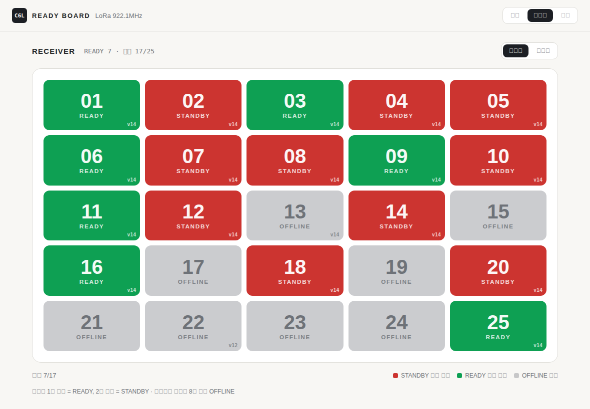

# c6l-contact-lora

M5Stack **Unit C6L** 26대로 만드는 접점 상태판입니다.

- 송신기 25대가 각각 접점 2개를 읽어 LoRa 로 보냅니다.
- 수신기 1대가 받아서 태블릿 웹페이지에 25칸으로 보여 줍니다.
- 펌웨어는 하나뿐이고, 본체 버튼으로 정한 **ID 가 역할을 정합니다**(0 = 수신기, 1~25 = 송신기).



## 배선 (송신기)

동봉된 Grove 케이블 한쪽을 잘라 씁니다.

| 선 | 신호 | 연결 |
|---|---|---|
| 흰색 | G4 | 접점 1 |
| 노란색 | G5 | 접점 2 |
| 검은색 | GND | 두 접점의 공통 |
| 빨간색 | 5V | **연결하지 않음** |

- **무전압(dry) 접점만** 연결합니다. 닫히면 ON 입니다.
- 풀업은 칩 내부 풀업을 씁니다. 외부 풀업이 필요하면 3.3V 에 걸어야 하고, 5V 는 안 됩니다.
- 선이 길면 직렬 1kΩ + GND 쪽 100nF 를 달거나 포토커플러로 분리합니다.

## ID 정하기 (본체 버튼)

1. 버튼을 **2초 길게** 누르면 설정 모드가 됩니다. OLED 에 `SET tap=+1` 이 뜹니다.
2. **짧게** 누를 때마다 ID 가 1 씩 올라갑니다. 25 다음은 `GW`(수신기)입니다.
3. 다시 **2초 길게** 누르면 저장하고 재부팅합니다. 20초 동안 아무것도 안 누르면 저장하지 않고 빠져나옵니다.

공장 상태는 `ID --` 이며, 이때는 아무것도 보내지 않습니다.

**시리얼로 정하기 (USB, 115200):** `id 0`(수신기) 또는 `id 1`~`id 25` 를 보내면 저장하고 재부팅합니다. 그 밖의 줄을 보내면 `id=… radio=… link=…` 상태를 돌려줍니다.

**시리얼 로그:**
- 송신기는 ACK 를 받을 때마다 `tx ok …` 를 찍고, 8번 연속 실패하면 `link lost` 를 찍습니다.
- 수신기는 패킷을 받을 때마다 `rx id=… rssi=…` 를 찍습니다.
- LoRa 초기화에 실패하면 `radio init try N: err=… i2c_fail=…` 를 찍고 최대 3번까지 다시 시도합니다.

## OLED 표시

- **송신기:** `ID 07` / `1:ON 2:--` / `link OK`. 수신기 ACK 가 8번 연속 실패하면 `link --` 가 됩니다.
- **수신기:** `GW` / `on 21/25` / `192.168.4.1`
- `LoRa ERR` 는 무선 칩 초기화에 실패했다는 뜻입니다. 시리얼 115200 에서 `radio=<코드>` 를 확인합니다.

## 태블릿

수신기가 Wi-Fi AP 를 띄웁니다.

1. 태블릿을 **`C6L-GW` / 비밀번호 `c6l-12345`** 에 연결합니다.
2. 브라우저에서 **http://192.168.4.1** 을 엽니다. 홈 화면에 추가하면 앱처럼 쓸 수 있습니다.

화면은 0.3초마다 갱신됩니다. 각 칸에는 다음이 표시됩니다.
- 접점별 ON/OFF
- 닫힌 횟수(×N, 255 다음 0)
- 마지막 수신 경과 시간과 RSSI

75초 동안 소식이 없으면 칸이 흐려지고 `끊김` 으로 바뀝니다. SSID·비밀번호는 `c6l-contact-lora.ino` 맨 위에서 바꿉니다.

## 동작 방식

- **무선 설정:** 922.1MHz, SF7, BW125k, CR4/5, +10dBm. 패킷 하나에 약 36ms, ACK 에 약 31ms 가 걸립니다.
- **송신:** 접점이 바뀌거나 30초가 지나면 보냅니다. 보내기 전에 CAD 로 채널이 비었는지 확인합니다(LBT). 수신기가 300ms 안에 ACK 를 주지 않으면 다시 보냅니다.
  - 재전송 간격은 처음 7번은 50~250ms×시도 횟수이고, 그 뒤로는 5~10초입니다.
  - 패킷에 현재 상태 전체를 담기 때문에 중간 패킷을 잃어도 다음 패킷이 바로잡습니다.
- **짧은 클릭:** 전송 사이에 열렸다 닫혀도 카운터가 올라가므로 화면의 ×N 으로 확인할 수 있습니다.
- **패킷 형식:** `C6 01 id seq bits cnt1 cnt2`, ACK 는 `C6 02 id seq` 입니다.

## 빌드·플래시

```bash
arduino-cli core install esp32:esp32        # 3.3.x, 보드 URL: https://espressif.github.io/arduino-esp32/package_esp32_index.json
arduino-cli lib install RadioLib U8g2       # RadioLib 8.x 기준 (7.x 와 begin() 형식이 다름)
arduino-cli compile --fqbn esp32:esp32:esp32c6:CDCOnBoot=cdc,PartitionScheme=no_fs --export-binaries .
arduino-cli upload  --fqbn esp32:esp32:esp32c6:CDCOnBoot=cdc,PartitionScheme=no_fs -p /dev/ttyACM0 .
```

- **USB 가 다른 PC 에 꽂혀 있을 때(Claude 세션):** Claude in Chrome 으로 그 PC 크롬에 esptool-js 를 엽니다.
  - 처음 한 번은 Connect 를 누르고 사용자가 포트를 고릅니다. 그다음 `file_upload` 로 바이너리를 넣고 0x0 에 굽습니다.
  - 권한을 받은 포트는 페이지에서 `import('https://cdn.jsdelivr.net/npm/esptool-js@0.7.1/+esm')` 로 불러온 `ESPLoader` 로 포트 선택 없이 다시 구울 수 있습니다.
  - 합본 이미지는 NVS 까지 덮어쓰므로 굽고 나면 `id N` 을 다시 보냅니다.
  - 리셋은 `setSignals({DTR:false, RTS:true})` 를 했다가 둘 다 false 로 돌립니다. DTR 이 켜진 채 리셋하면 다운로드 모드로 들어갑니다.
- **arduino-cli 없이 굽기:** `build/esp32.esp32.esp32c6/c6l-contact-lora.ino.merged.bin` 을 [esptool-js](https://espressif.github.io/esptool-js/) 로 주소 `0x0` 에 굽습니다.
- **다운로드 모드:** 측면 버튼을 녹색 LED 가 빨강으로 바뀔 때까지 누르고 있다가 뗍니다.

## 출처·주의

- **핀·IO 확장칩 초기화:** Meshtastic `variants/esp32c6/m5stack_unitc6l` 기준입니다.
- **RF 설정(TCXO 3.0V on DIO3, RF 스위치 = DIO2):** Stamp C6LoRa 회로도에서 가져왔습니다.
- **안테나:** 동봉 LoRa 안테나는 868MHz 용입니다. 국내(920MHz 대)에서는 915~923MHz 안테나가 낫습니다.
- **국내 규정:** 출력·LBT 조건은 현장에 쓰기 전에 다시 확인합니다.
- **수신기 실기기 확인(2026-11-09, 2번째 모듈):**
  - 시리얼 `id 0` 으로 GW 로 설정하자 OLED 에 `GW` 가 표시됐습니다.
  - 첫 부팅에서 `radio=-2` 가 한 번 났지만, 이후 리셋 6번은 모두 `radio=0` 이었습니다. 그래서 초기화 재시도를 넣었습니다.
- **송신기 실기기 확인(2026-11-09, 1대):** 다음 항목이 실제 기기에서 정상이었습니다.
  - esptool-js 로 굽기
  - 부팅 로그 `radio=0`(IO 확장칩·SX1262·TCXO 3.0V·DIO2 RF 스위치 정상)
  - OLED(`U8G2_SSD1306_64X48_ER`) 표시
  - 버튼(P0)으로 ID 설정 → NVS 저장 → 재부팅 후 `id=1`
- **미검증:** LoRa 송수신·ACK(2대 필요), 접점 입력, 수신기 Wi-Fi·태블릿 페이지, 25대가 동시에 바뀔 때의 전달 시간.
